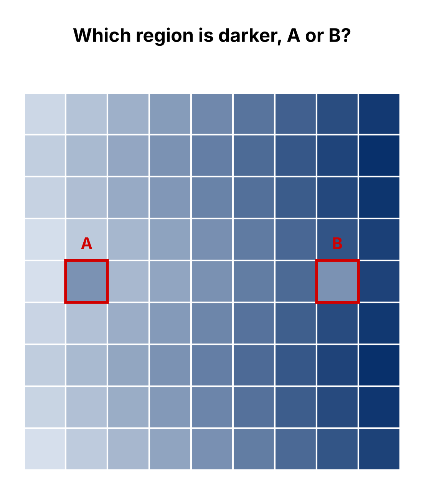
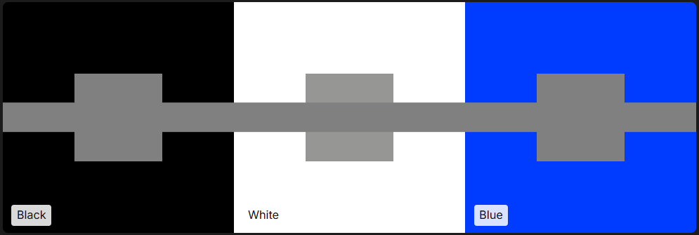

# Same Color Test

An interactive experiment that shows how **color perception depends on context**: the same color looks different on different backgrounds.

**Live demo:** https://hanaamaswada.github.io/same-color-test/

*Regions A and B have exactly the same color. They look different only because of their neighbours.*

## The experiment

1. Three large backgrounds are placed side by side: black, white and a strong blue (RGB 0, 60, 255).
2. A small square with exactly the same color is placed in the middle of each one, e.g. mid grey RGB 128, 128, 128.
3. Observe whether the three squares look equally light, equally saturated and equally large.
4. Adjust the square on white with the R, G, B sliders until it looks like the square on black, and read the values.

A **proof strip** draws a bar of the original color through all three squares to show that they really share the same value.

## My result

| Square | R | G | B |
|---|---|---|---|
| On black (original) | 128 | 128 | 128 |
| On white (matched) | 150 | 151 | 149 |
| Change needed | +22 | +23 | +21 |

To look the same as the grey on black, the grey on white had to be about **22 steps (≈ 17 %) lighter**. All three channels changed by almost the same amount, so the effect is mainly in **lightness**.

*The strip (RGB 128) matches the squares on black and blue, while the matched square on white is lighter, even though it looked the same as the one on black.*

## Why it happens

Color perception is **relative, not absolute**. The retina groups receptors into receptive fields that respond to the **local average intensity** around an object and **enhance contrast**. A grey surrounded by black is therefore seen as lighter, and on white as darker. On a strongly colored background, the eye also shifts a neutral grey towards the opposite color (on blue it looks slightly yellowish), because color is processed in opponent pairs: blue–yellow and red–green.

## What it means for data visualization

- On **heatmaps and choropleth maps**, two regions with the same value can look different because of their neighbours, so readers may place them in the wrong class.
- A palette designed for **light mode** cannot simply be reused in **dark mode**; each mode needs its own colors, tested on its own background.
- For **precise comparison**, do not rely on color alone: add labels, tooltips or a position-based chart such as a bar chart.

## How to use

Open the [live demo](https://hanaamaswada.github.io/same-color-test/) or download `index.html` and open it in any browser. Keep the zoom at 100 %.

- Choose a test color: orange (230, 140, 40), grey (128, 128, 128) or any custom color.
- Change the third background to blue, red or green.
- Use **Show proof strip** to check that the squares are identical.
- Move the **R, G, B** sliders to match the square on white, then use **Copy result**.

## Built with

Plain HTML, CSS and JavaScript in a single file, with no libraries and no build step.

## Background

Built as part of the *Data Visualization* course in the Master's program in Intelligent Systems Engineering (Data Science) at Palestine Polytechnic University.

**Author:** Hanaa Maswada · [LinkedIn](https://www.linkedin.com/in/hana-maswada-961b2337b) · [GitHub](https://github.com/HanaaMaswada)
